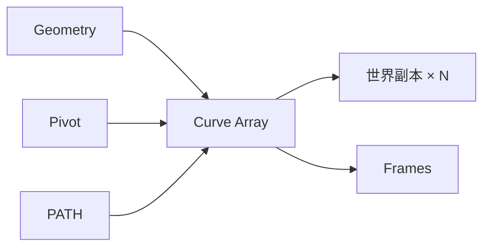

# Curve Array

| 字段 | 值 |
|---|---|
| 节点 ID | `pattern.linear.curve_array` |
| 分类 | `pattern.linear` |
| 显示名称 | Curve Array |
| 效果 | `PURE` |

## 作用

沿曲线用平行传输 Frame + 放置复制几何。Count 与 Spacing 控制采样。

## 示意图



```text
  路径 ●────●────●────●
  放置   G0   G1   G2   G3   ← 平行传输姿态
  Count 固定个数；或 Spacing 定间距（二选一驱动）
```

只要 Frame 不要复制几何时，用 [Path Frames](./path_frames.md) + [Place On Frames](../../transform/placement/place_geometry_on_frames.md)。

## 端点

| 方向 | 显示名 | 类型 |
|---|---|---|
| 入 | Geometry / Pivot / Path / Count / Spacing / Up Vector | … |
| 出 | Geometry / Origins / Frames / Trees / Count | … |

## 使用步骤

1. 接入几何或点列，以及变换/阵列参数。
2. 输出接到下游放置、预览或体素化。

## 典型接法

```text
[上游].… ──► [Curve Array].Geometry
[Curve Array].Geometry ──► [下游].…
```
