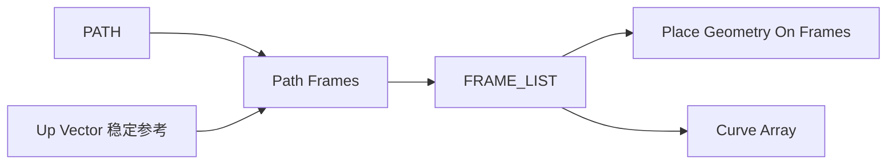

# Path Frames

| 字段 | 值 |
|---|---|
| 节点 ID | `pattern.linear.path_frames` |
| 分类 | `pattern.linear` |
| 显示名称 | Path Frames |
| 效果 | `PURE` |

## 作用

在路径顶点生成平行传输 Frame（+ 切向、长度）。

## 示意图



```text
  路径顶点 ●────●────●────●
  Frame:   F0   F1   F2   F3
           ↑Y   ↑Y   ↑Y   ↑Y   ← 平行传输，减少扭转跳变
           →T   →T   →T   →T   ← 切向
```

Up Vector 用于稳定绕切向的滚转；闭合路径注意首尾 Frame 是否平滑。

## 端点

| 方向 | 显示名 | 类型 |
|---|---|---|
| 入 | Path / Up Vector | PATH / VECTOR |
| 出 | Frames / Points / Tangents / Count / Length | FRAME_LIST / … |

## 使用步骤

1. 接入几何或点列，以及变换/阵列参数。
2. 输出接到下游放置、预览或体素化。

## 典型接法

```text
[Path].Path ──► [Path Frames].Path
[Path Frames].Frames ──► [Place Geometry On Frames].Frames
```
