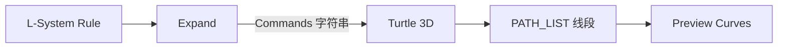

# L-System Turtle 3D

| 字段 | 值 |
|---|---|
| 节点 ID | `pattern.lsystem.turtle_3d` |
| 分类 | `pattern.lsystem` |
| 显示名称 | L-System Turtle 3D |
| 效果 | `PURE` |

## 作用

解释命令为独立 3D 线段（PATH_LIST）：`F` 画、`f` 移、`+-` 偏航、`&/^` 俯仰、`/\\` 滚转、`[]` 栈。

## 示意图



| 命令 | 含义 |
|---|---|
| `F` | 前进并画线 |
| `f` | 前进不画线 |
| `+` / `-` | 偏航（绕上轴） |
| `&` / `^` | 俯仰 |
| `/` / `\` | 滚转 |
| `[` / `]` | 压栈 / 出栈（分枝） |

```text
  F[+F][-F]F     →    主干 + 左右分枝 + 续干
```

上游通常：Rule → Expand → 本节点。

## 端点

| 方向 | 显示名 | 类型 |
|---|---|---|
| 入 | Commands / Step / Angle / Origin | STRING / DOUBLE / POINT |
| 出 | Paths / Points / Segment Count / Hit Limit | PATH_LIST / … |
| 出 | Valid / Error | `output_valid` / `output_error` | BOOLEAN / STRING |

## 使用步骤

1. Commands 接 Expand 的 String；设好 Step / Angle / Origin。
2. 看 Paths / Segment Count；Hit Limit 为真说明触达上限。
3. Paths 可 Preview Curves，或转点列做阵列。

## 典型接法

```text
[L-System Expand].String ──► [Turtle 3D].Commands
[Turtle 3D].Paths ──► [Preview Curves].Paths
```
