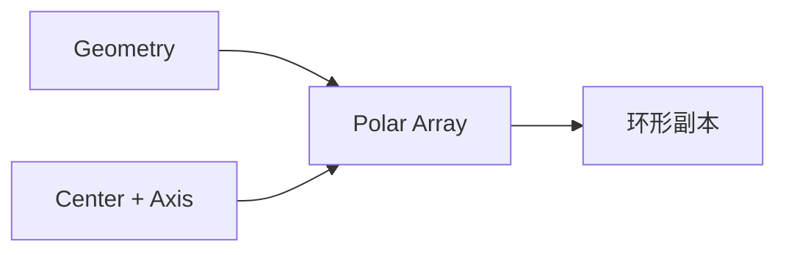

# Polar Array

| 字段 | 值 |
|---|---|
| 节点 ID | `pattern.radial.polar_array` |
| 分类 | `pattern.radial` |
| 显示名称 | Polar Array |
| 效果 | `PURE` |

## 作用

绕 Center + Axis 旋转复制几何；Total Angle 为总扫角（度）。

## 示意图



```text
         G1
      ╱      ╲
   G0    ●C    G2     Axis 穿出纸面
      ╲      ╱
         G3
  Total Angle=360、Count=4 → 每份 90°
```

## 端点

| 方向 | 显示名 | 类型 |
|---|---|---|
| 入 | Geometry / Center / Axis / Count / Total Angle | … |
| 出 | Geometry / Geometry Tree / Count | … |

## 使用步骤

1. 接入几何或点列，以及变换/阵列参数。
2. 输出接到下游放置、预览或体素化。

## 典型接法

```text
[上游].… ──► [Polar Array].Geometry
[Polar Array].Geometry ──► [下游].…
```
