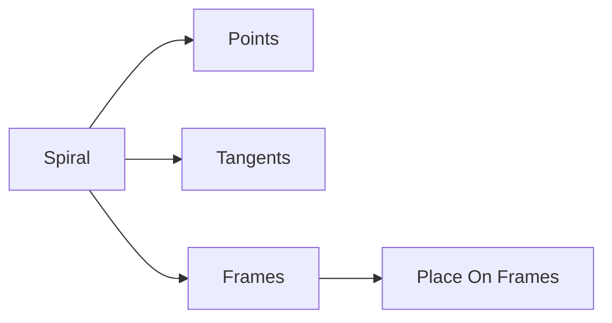

# Spiral

| 字段 | 值 |
|---|---|
| 节点 ID | `pattern.radial.spiral` |
| 分类 | `pattern.radial` |
| 显示名称 | Spiral |
| 效果 | `PURE` |

## 作用

螺旋锚点 + 切向 + 放置 Frame。

## 示意图



```text
  俯视:  ·  ·   ·
       ·       ·     Radius 随 Radius Step 增大
         ·   ·       Height 随 Height Step 上升
           ● Origin
  Turns × Count 控制圈数与点数
```

叶序见 [Phyllotaxis](./phyllotaxis.md)。

## 端点

| 方向 | 显示名 | 类型 |
|---|---|---|
| 入 | Origin / Turns / Count / Start Radius / Radius·Height Step / Start Angle | … |
| 出 | Points / Tangents / Frames / Count | … |

## 使用步骤

1. 接入几何或点列，以及变换/阵列参数。
2. 输出接到下游放置、预览或体素化。

## 典型接法

```text
[上游].… ──► [Spiral].Origin
[Spiral].Points ──► [下游].…
```
