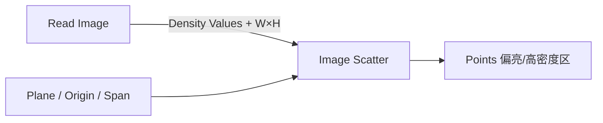

# Image Scatter

| 字段 | 值 |
|---|---|
| 节点 ID | `pattern.surface_volume_distribution.image_scatter` |
| 分类 | `pattern.surface_volume_distribution` |
| 显示名称 | Image Scatter |
| 效果 | `PURE` |

## 作用

用精确尺寸密度图在平面或世界 XZ 上散射（上游 Read Image 等提供 Density Values）。

## 示意图



```text
  密度图（W×H）        平面 Span U×V
  ░░██░░          →    ·  ●●  ·
  ░████░                 ●●●●
  ░░██░░               ·  ●●  ·
  Threshold / Invert 控制哪些像素参与
```

Density Values 长度须为 Width×Height；与 [Poisson Disk](./poisson_disk_plane.md) 不同，本节点由图像驱动疏密。

## 端点

| 方向 | 显示名 | 类型 |
|---|---|---|
| 入 | Density Values / Image Width·Height / Plane / Origin / Span U·V | DOUBLE_LIST / … |
| 入 | Target Count / Seed / Threshold / Invert | INTEGER / DOUBLE / BOOLEAN |
| 出 | Points / U·V Values / Density Values / Count | … |

## 使用步骤

1. 接入几何或点列，以及变换/阵列参数。
2. 输出接到下游放置、预览或体素化。

## 典型接法

```text
[上游].… ──► [Image Scatter].Density Values
[Image Scatter].Points ──► [下游].…
```
