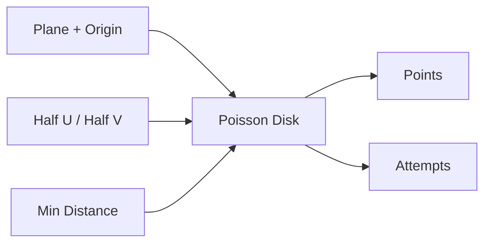

# Poisson Disk On Plane

| 字段 | 值 |
|---|---|
| 节点 ID | `pattern.surface_volume_distribution.poisson_disk_plane` |
| 分类 | `pattern.surface_volume_distribution` |
| 显示名称 | Poisson Disk On Plane |
| 效果 | `PURE` |

## 作用

平面 UV 矩形内泊松盘拒绝采样（最小间距）。

## 示意图



```text
  UV 矩形内：
    ●    ●      任意两点距离 ≥ Min Distance
       ●    ●   Target Count 为上限；达不到时 Count < Target
    ●      ●    Attempts = 拒绝采样尝试次数
```

比纯随机更均匀；要贴曲面用 [Scatter On Surface](./scatter_surface.md)。

## 端点

| 方向 | 显示名 | 类型 |
|---|---|---|
| 入 | Plane / Origin / Half U·V / Target Count / Min Distance / Seed | … |
| 出 | Points / Count / Attempts | … |

## 使用步骤

1. 接入几何或点列，以及变换/阵列参数。
2. 输出接到下游放置、预览或体素化。

## 典型接法

```text
[上游].… ──► [Poisson Disk On Plane].Plane
[Poisson Disk On Plane].Points ──► [下游].…
```
