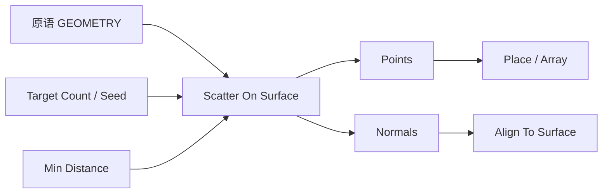

# Scatter On Surface

| 字段 | 值 |
|---|---|
| 节点 ID | `pattern.surface_volume_distribution.scatter_surface` |
| 分类 | `pattern.surface_volume_distribution` |
| 显示名称 | Scatter On Surface |
| 效果 | `PURE` |

## 作用

在支持的原语表面散射点（随机或近似蓝噪声）。柱/锥仅侧面；连续解析采样。Min Distance 控制间距。

## 示意图



```text
  球体表面 ● ● ●     Min Distance ↑ → 更疏、更「蓝噪声」
           ●   ●     Count 达不到时以间距优先（近似）
             ●
  柱/锥：只在侧面采样，不含顶底（按实现）
```

## 端点

| 方向 | 显示名 | 类型 |
|---|---|---|
| 入 | Geometry / Target Count / Seed / Min Distance | GEOMETRY / INTEGER / DOUBLE |
| 出 | Points / Normals / Count | … |

## 使用步骤

1. 接入几何或点列，以及变换/阵列参数。
2. 输出接到下游放置、预览或体素化。

## 典型接法

```text
[上游].… ──► [Scatter On Surface].Geometry
[Scatter On Surface].Points ──► [下游].…
```
