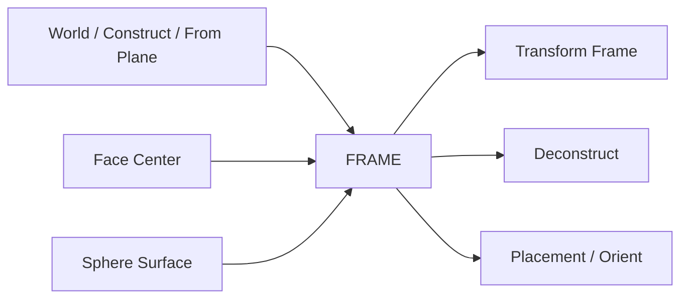

# reference.frames — 局部坐标系（FRAME）

FRAME = 原点 + 右手正交 XYZ 轴，用于放置、朝向、阵列与变换。Z 常作法线 /「上」方向（与 Plane 的法线对应）。

| 节点 | 教程 | 一句话 |
|---|---|---|
| Face Center Frame | [frame_from_face.md](./frame_from_face.md) | 盒体面中心正交架 |
| Sphere Surface Frame | [sphere_surface_frame.md](./sphere_surface_frame.md) | 球面投影点切向架 |
| World Frame | [world_frame.md](./world_frame.md) | 世界原点单位架 |
| Construct Frame | [construct_frame.md](./construct_frame.md) | Origin + X/Y → Z=X×Y |
| Frame From Plane | [frame_from_plane.md](./frame_from_plane.md) | 平面上建架（Z=法线） |
| Transform Frame | [transform_frame.md](./transform_frame.md) | 平移 + 世界轴欧拉（度） |
| Deconstruct Frame | [deconstruct_frame.md](./deconstruct_frame.md) | 拆单架 |
| Deconstruct Frames | [deconstruct_frames.md](./deconstruct_frames.md) | 拆 FRAME_LIST |

进度见 [PROGRESS.md](../../PROGRESS.md)。
