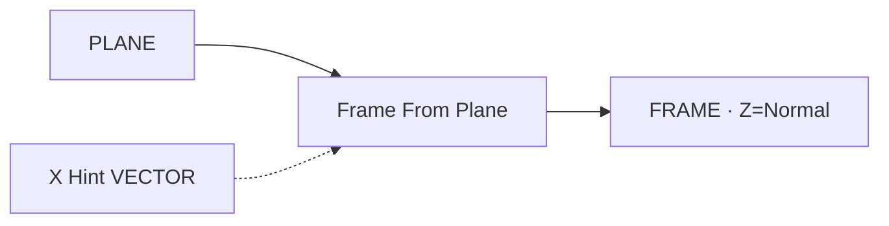

# Frame From Plane

| 字段 | 值 |
|---|---|
| 节点 ID | `reference.frames.frame_from_plane` |
| 分类 | `reference.frames` |
| 显示名称 | Frame From Plane |
| 效果 | `PURE` |

## 作用

在平面上建右手正交 FRAME：**Z = 平面法线**，X 尽量对齐可选的 **X Hint**（面内投影），再求出 Y。衔接 `reference.planes` 与放置工作流。



## 端点

### 输入

| 显示名 | 端口 ID | 类型 | 说明 |
|---|---|---|---|
| Plane | `input_plane` | PLANE | 源平面（原点 + 法线） |
| X Hint | `input_x_hint` | VECTOR | 可选；面内 X 方向提示 |

### 输出

| 显示名 | 端口 ID | 类型 | 说明 |
|---|---|---|---|
| Frame | `output_frame` | FRAME | 平面上的正交架 |
| Valid / Error | `output_valid` / `output_error` | BOOLEAN / STRING | 是否成功 |

## 使用步骤

1. 接 World Plane / Construct Plane 等。
2. （可选）接 X Hint，控制面内「朝前」方向。
3. 用 Frame 做截面轮廓朝向或物体放置。

## 典型接法

```text
[World Plane].Plane ──► [Frame From Plane].Plane
[Frame From Plane].Frame ──► [Rectangle On Plane / 放置]
```

## 注意事项

- Hint 若与法线平行，系统会选备用面内方向；极端退化看 Valid。
