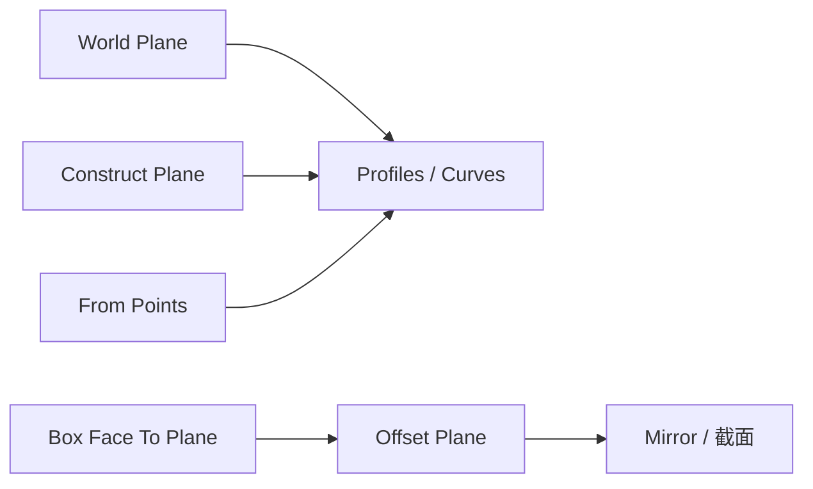

# reference.planes — 平面参照

定义、偏移、拆解平面，以及点到平面距离。常接到截面轮廓、镜像、Frame From Plane 等。

| 节点 | 教程 | 一句话 |
|---|---|---|
| World Plane | [world_plane.md](./world_plane.md) | XY / YZ / XZ 世界预设平面 |
| Construct Plane | [construct_plane.md](./construct_plane.md) | 原点 + 法线 |
| Construct Plane From Points | [plane_from_points.md](./plane_from_points.md) | 三点定面 |
| Box Face To Plane | [box_face_plane.md](./box_face_plane.md) | 盒体面 → 支撑平面 |
| Offset Plane | [offset_plane.md](./offset_plane.md) | 沿法线有符号偏移 |
| Distance Point To Plane | [distance_point_to_plane.md](./distance_point_to_plane.md) | 绝对 / 有符号距离 |
| Deconstruct Plane | [deconstruct_plane.md](./deconstruct_plane.md) | 拆出 Origin + Normal |

**World Plane 法线约定**：XY = +Z，YZ = +X，XZ = +Y（默认预设常为 XZ，即水平面法线向上）。

进度见 [PROGRESS.md](../../PROGRESS.md)。
