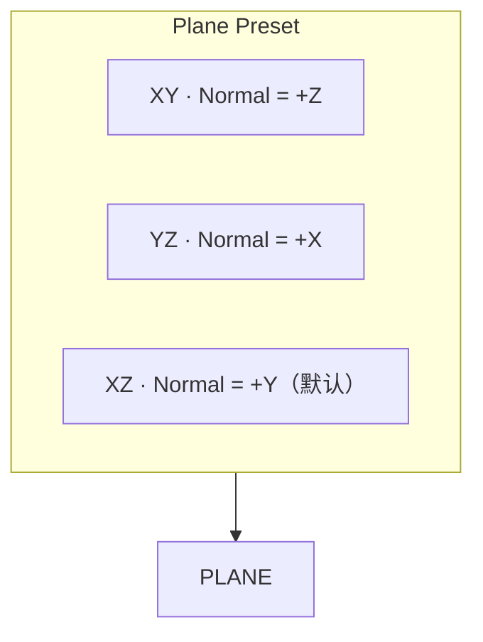

# World Plane

| 字段 | 值 |
|---|---|
| 节点 ID | `reference.planes.world_plane` |
| 分类 | `reference.planes` |
| 显示名称 | World Plane |
| 效果 | `PURE` |

## 作用

按世界轴预设生成标准平面（带 Point 兼容的原点）。最常用作水平地面（XZ）或竖直墙面（XY / YZ）。



## 端点

### 输入

| 显示名 | 端口 ID | 类型 | 说明 |
|---|---|---|---|
| Origin | `input_origin` | POINT | 可选；覆盖属性里的原点。Block Pos / Vector 等可经类型转换接入 |

### 输出

| 显示名 | 端口 ID | 类型 | 说明 |
|---|---|---|---|
| Plane | `output_plane` | PLANE | 构造的平面 |
| Valid | `output_valid` | BOOLEAN | 是否构造成功 |
| Error | `output_error` | STRING | 失败原因 |

### 属性

| 属性 | 默认 | 说明 |
|---|---|---|
| Plane Preset | `XZ` | XY / YZ / XZ |
| Origin X/Y/Z | `0` | 未接 Origin 口时使用 |

## 使用步骤

1. 选 Preset（水平面用 XZ）。
2. （可选）接 Origin，或改 Origin XYZ。
3. 把 **Plane** 接到轮廓 / 曲线 / Frame From Plane。

## 典型接法

```text
[Player Position].Position ──► [World Plane].Origin
[World Plane].Plane        ──► [Rectangle On Plane].Plane
```

## 注意事项

- 法线：XY→+Z，YZ→+X，XZ→+Y。
- 原点非有限 → Valid false。
