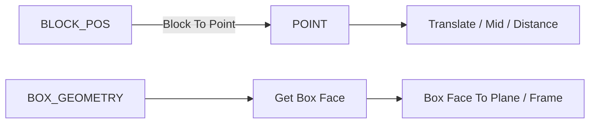

# reference.points — 点与盒体拓扑

区分 **BLOCK_POS**（整数格点）与 **POINT**（连续几何点）。盒体面/边查询常接到建筑构件与 Frame。

| 分组 | 教程 |
|---|---|
| 方块坐标 | [block_position](./block_position.md) · [construct_coordinate](./construct_coordinate.md) · [deconstruct_block_position](./deconstruct_block_position.md) · [point_from_block](./point_from_block.md) |
| 几何点 | [construct_point](./construct_point.md) · [deconstruct_point](./deconstruct_point.md) · [translate_point](./translate_point.md) · [point_along_vector](./point_along_vector.md) |
| 两点关系 | [mid_point](./mid_point.md) · [distance_between_points](./distance_between_points.md) · [vector_between_points](./vector_between_points.md) |
| 点列 | [closest_point](./closest_point.md) · [point_list_center](./point_list_center.md) · [point_list_bounds](./point_list_bounds.md) |
| 盒体 | [get_box_corner](./get_box_corner.md) · [get_box_face](./get_box_face.md) · [get_face_edge](./get_face_edge.md) · [deconstruct_face](./deconstruct_face.md) · [deconstruct_edge](./deconstruct_edge.md) |

进度见 [PROGRESS.md](../../PROGRESS.md)。
