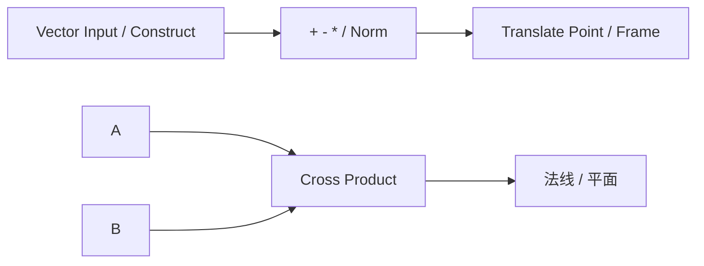

# reference.vectors — 向量运算

3D `VECTOR` 的输入、拆解与代数运算。与 `reference.points` 配合：点差 → 向量，向量 → 平移点。

| 分组 | 教程 |
|---|---|
| 输入 | [vector](./vector.md) · [vector2_input](./vector2_input.md) · [construct_vector](./construct_vector.md) · [deconstruct_vector](./deconstruct_vector.md) |
| 模长 | [vector_length](./vector_length.md) · [normalize_vector](./normalize_vector.md) |
| 加减乘除 | [vector_addition](./vector_addition.md) · [vector_subtraction](./vector_subtraction.md) · [vector_scalar_multiply](./vector_scalar_multiply.md) · [vector_scalar_divide](./vector_scalar_divide.md) |
| 积与角 | [dot_product](./dot_product.md) · [cross_product](./cross_product.md) · [angle_between](./angle_between.md) |
| 插值 / 投影 | [lerp_vectors](./lerp_vectors.md) · [slerp](./slerp.md) · [reflect](./reflect.md) · [project](./project.md) |

角度输出为**度**。进度见 [PROGRESS.md](../../PROGRESS.md)。
