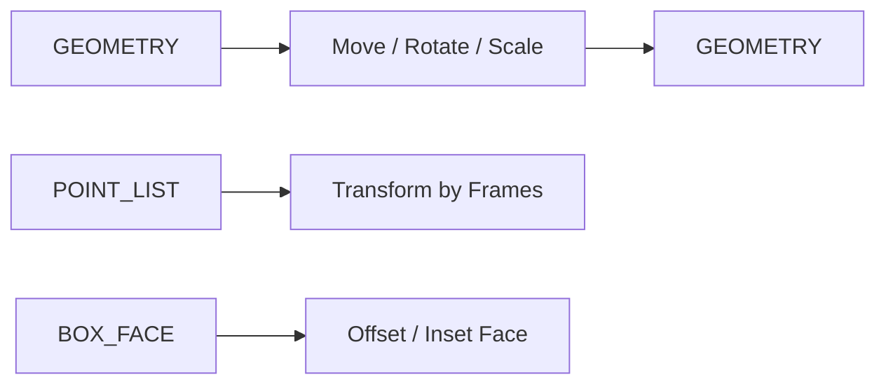

# transform.basic_transforms — 基础变换

平移 / 旋转 / 缩放 / 镜像解析几何，以及点列按 Frame 展开、盒体面偏移。

| 分组 | 教程 |
|---|---|
| 刚体/相似 | [move](./move_geometry.md) · [rotate](./rotate_geometry_axis.md) · [scale](./scale_geometry_point.md) · [transform](./transform_geometry.md) |
| 镜像 | [mirror_geometry](./mirror_geometry_plane.md) · [mirror_points](./mirror_point_list_plane.md) |
| 点/面 | [transform_by_frames](./transform_by_frames.md) · [offset_face](./offset_face.md) · [inset_face](./inset_face.md) |

