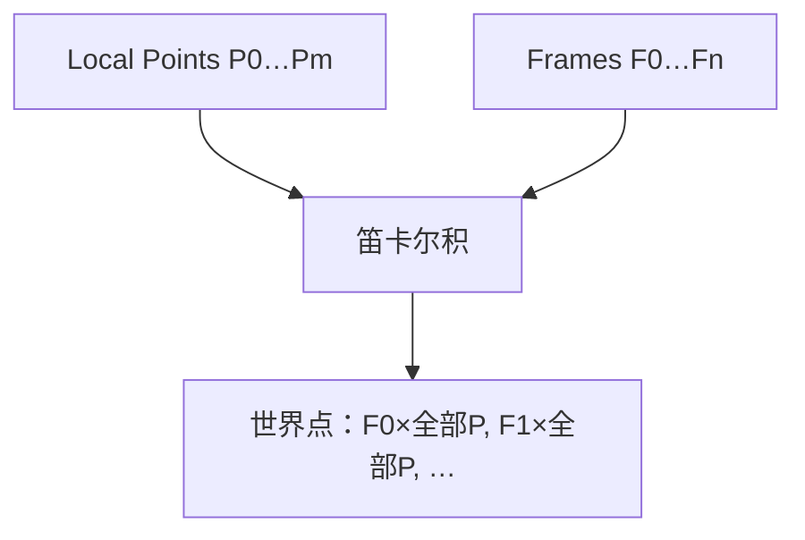

# Transform Points by Frames

| 字段 | 值 |
|---|---|
| 节点 ID | `transform.basic_transforms.transform_by_frames` |
| 分类 | `transform.basic_transforms` |
| 显示名称 | Transform Points by Frames |
| 效果 | `PURE` |

## 作用

局部 POINT_LIST × FRAME_LIST → 世界点（笛卡尔：Frame0×全部点，Frame1×全部点，…）。

## 示意图



```text
  Points:  3 个局部点
  Frames:  4 个放置 Frame
  输出:    3 × 4 = 12 个世界点（按 Frame 分组串联）
```

与 [Place Geometry On Frames](../placement/place_geometry_on_frames.md) 的区别：这里只变换**点列**，不复制实体几何。

## 端点

| 方向 | 显示名 | 类型 |
|---|---|---|
| 入 | Local Points / Frames | POINT_LIST / FRAME_LIST |
| 出 | Points / Count | POINT_LIST / INTEGER |
| 出 | Valid / Error | `output_valid` / `output_error` | BOOLEAN / STRING |

## 使用步骤

1. 接入几何或点列，以及变换/阵列参数。
2. 输出接到下游放置、预览或体素化。

## 典型接法

```text
[Column 局部截面点] ──► Local Points
[Column Grid].Frames ──► Frames
[Transform by Frames].Points ──► 下游
```
