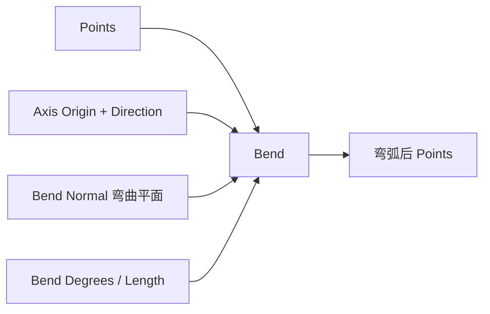

# Bend Point List

| 字段 | 值 |
|---|---|
| 节点 ID | `transform.deformations.bend` |
| 分类 | `transform.deformations` |
| 显示名称 | Bend Point List |
| 效果 | `PURE` |

## 作用

沿轴把点列弯成弧；Bend Normal 定义弯曲平面，Bend Length 为作用长度。

## 示意图



```text
  轴 →  ●●●●●●●●●  直段
            ╲
             ●●●●    Bend Degrees
               ╲●●
  Bend Normal 指出弯曲所在平面；Length = 参与弯曲的轴向跨度
```

SDF 域弯曲见 [Bend SDF](./bend_sdf.md)。

## 端点

| 方向 | 显示名 | 类型 |
|---|---|---|
| 入 | Points / Axis Origin·Direction / Bend Normal / Bend Degrees / Bend Length | … |
| 出 | Points / Count | … |
| 出 | Valid / Error | `output_valid` / `output_error` | BOOLEAN / STRING |

## 使用步骤

1. 接入几何或点列，以及变换/阵列参数。
2. 输出接到下游放置、预览或体素化。

## 典型接法

```text
[上游].… ──► [Bend Point List].Points
[Bend Point List].Points ──► [下游].…
```
