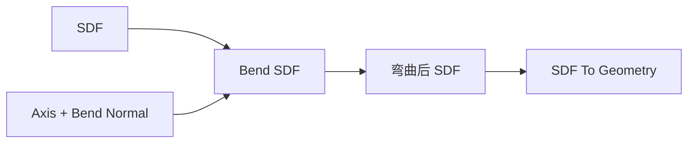

# Bend SDF

| 字段 | 值 |
|---|---|
| 节点 ID | `transform.deformations.bend_sdf` |
| 分类 | `transform.deformations` |
| 显示名称 | Bend SDF |
| 效果 | `PURE` |

## 作用

对 SDF 做轴向弯曲域变形。

## 示意图



```text
  采样点 p ──逆弯曲──► p' ──再采样原 SDF
  （域变形：几何看起来弯了，场定义在弯曲空间）
```

与点列 [Bend](./bend.md) 对应；记得更新 Bounds。

## 端点

| 方向 | 显示名 | 类型 |
|---|---|---|
| 入 | SDF / Axis Origin·Direction / Bend Normal / Bend Degrees / Bend Length / Bounds* | … |
| 出 | SDF / Bounds Min·Max | … |
| 出 | Valid / Error | `output_valid` / `output_error` | BOOLEAN / STRING |

## 使用步骤

1. 接入几何或点列，以及变换/阵列参数。
2. 输出接到下游放置、预览或体素化。

## 典型接法

```text
[上游].… ──► [Bend SDF].SDF
[Bend SDF].SDF ──► [下游].…
```
