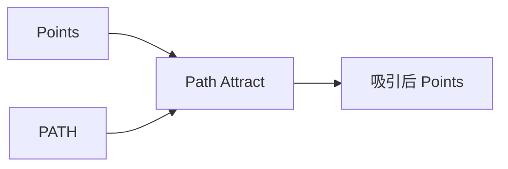

# Path Attract Point List

| 字段 | 值 |
|---|---|
| 节点 ID | `transform.deformations.curve_attract` |
| 分类 | `transform.deformations` |
| 显示名称 | Path Attract Point List |
| 效果 | `PURE` |

## 作用

把点拉向 PATH，二次衰减。面板 **Displacement**：`TOWARD_POINT`（全向量）/ 仅切向 / 仅垂直切向。

## 示意图



```text
  路径 ───────────────
       ↑ 垂直分量     → 切向分量
  ● ───┘              Displacement 模式：
  ●────● 最近点         TOWARD_POINT = 全向量
  Radius 外强度→0       仅切向 / 仅垂直
```

Strength × 二次衰减（距路径最近点）；适合把散点「吸附」到中心线。

## 端点

| 方向 | 显示名 | 类型 |
|---|---|---|
| 入 | Points / Path / Strength / Radius | POINT_LIST / PATH / DOUBLE |
| 出 | Points / Count | … |
| 出 | Valid / Error | `output_valid` / `output_error` | BOOLEAN / STRING |

## 使用步骤

1. 接入几何或点列，以及变换/阵列参数。
2. 输出接到下游放置、预览或体素化。

## 典型接法

```text
[上游].… ──► [Path Attract Point List].Points
[Path Attract Point List].Points ──► [下游].…
```
