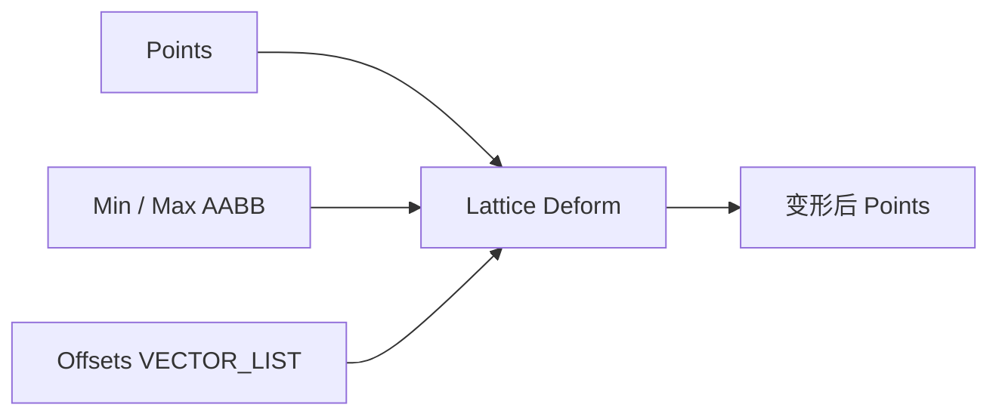

# Lattice Deform Point List

| 字段 | 值 |
|---|---|
| 节点 ID | `transform.deformations.lattice_deform` |
| 分类 | `transform.deformations` |
| 显示名称 | Lattice Deform Point List |
| 效果 | `PURE` |

## 作用

自由变形：轴对齐盒内均匀格子，三线性混合控制位移。Offsets 顺序 `i + (nx+1)*(j + (ny+1)*k)`；格子划分在面板（gridX/Y/Z）。

## 示意图



```text
  控制格 (nx+1)×(ny+1)×(nz+1)
       ●───●───●
      /│  /│  /│
     ●───●───● │     每格点一个位移 Offset
     │ ●─│─●─│─●     点在盒内三线性插值
     │/  │/  │/
     ●───●───●
  索引: i + (nx+1)*(j + (ny+1)*k)
```

Offsets 长度须等于控制点数；盒外点通常不受影响或按实现钳制。

## 端点

| 方向 | 显示名 | 类型 |
|---|---|---|
| 入 | Points / Min / Max / Offsets | POINT_LIST / POINT / VECTOR_LIST |
| 出 | Points / Count | … |
| 出 | Valid / Error | `output_valid` / `output_error` | BOOLEAN / STRING |

## 使用步骤

1. 接入几何或点列，以及变换/阵列参数。
2. 输出接到下游放置、预览或体素化。

## 典型接法

```text
[上游].… ──► [Lattice Deform Point List].Points
[Lattice Deform Point List].Points ──► [下游].…
```
