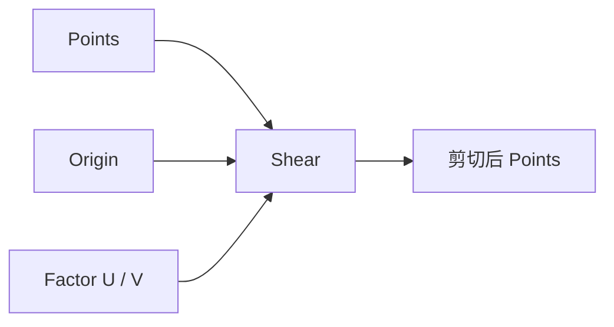

# Shear Point List

| 字段 | 值 |
|---|---|
| 节点 ID | `transform.deformations.shear_point_list` |
| 分类 | `transform.deformations` |
| 显示名称 | Shear Point List |
| 效果 | `PURE` |

## 作用

绕 Origin 做轴向剪切（Factor U / Factor V）。

## 示意图



```text
  原形 ███      Factor U>0
      ███   →    ▒███     沿 U 方向错切
      ███         ▒███
  Origin 为不动参考；V 为第二剪切分量
```

## 端点

| 方向 | 显示名 | 类型 |
|---|---|---|
| 入 | Points / Origin / Factor U / Factor V | … |
| 出 | Points / Count | … |
| 出 | Valid / Error | `output_valid` / `output_error` | BOOLEAN / STRING |

## 使用步骤

1. 接入几何或点列，以及变换/阵列参数。
2. 输出接到下游放置、预览或体素化。

## 典型接法

```text
[上游].… ──► [Shear Point List].Points
[Shear Point List].Points ──► [下游].…
```
