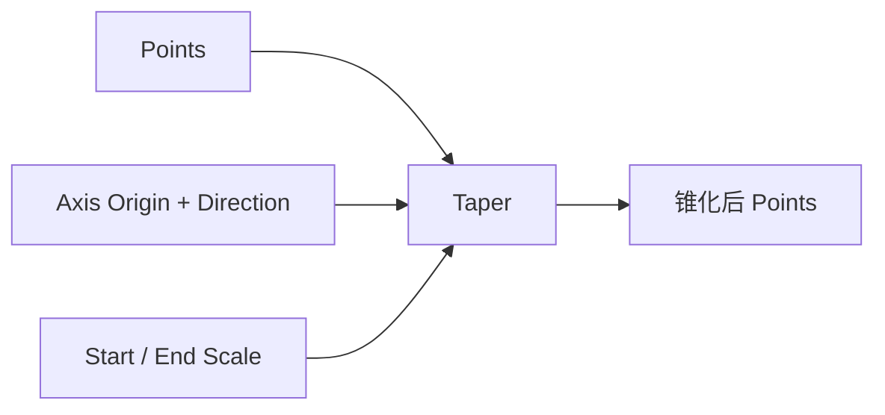

# Taper Point List

| 字段 | 值 |
|---|---|
| 节点 ID | `transform.deformations.taper` |
| 分类 | `transform.deformations` |
| 显示名称 | Taper Point List |
| 效果 | `PURE` |

## 作用

沿轴缩放径向距离，形成锥形（Start Scale → End Scale）。

## 示意图



```text
  Start Scale=1.0    ●●●●●●●●
  沿轴 →             ●●●●●●
  End Scale=0.3        ●●●
```

只缩放垂直于轴的径向分量；轴向位置不变。

## 端点

| 方向 | 显示名 | 类型 |
|---|---|---|
| 入 | Points / Axis Origin·Direction / Start·End Scale / Taper Length | … |
| 出 | Points / Count | … |
| 出 | Valid / Error | `output_valid` / `output_error` | BOOLEAN / STRING |

## 使用步骤

1. 接入几何或点列，以及变换/阵列参数。
2. 输出接到下游放置、预览或体素化。

## 典型接法

```text
[上游].… ──► [Taper Point List].Points
[Taper Point List].Points ──► [下游].…
```
