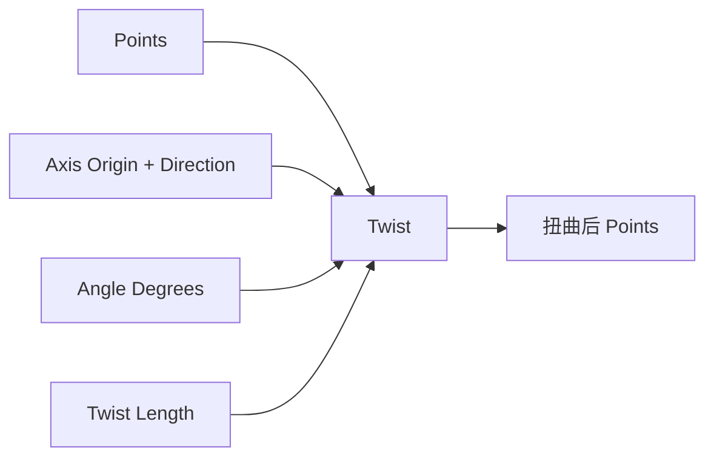

# Twist Point List

| 字段 | 值 |
|---|---|
| 节点 ID | `transform.deformations.twist` |
| 分类 | `transform.deformations` |
| 显示名称 | Twist Point List |
| 效果 | `PURE` |

## 作用

绕轴扭转点列：总转角沿 Twist Length 轴向分配。

## 示意图



```text
  轴 →          0% 处转角 ≈ 0
  ●●●●●●●●●     沿轴向线性加扭
  ●  ●  ●  ●    100%（Twist Length）处 = Angle Degrees
   ●  ●  ●
```

SDF 域扭转见 [Twist SDF](./twist_sdf.md)。

## 端点

| 方向 | 显示名 | 类型 |
|---|---|---|
| 入 | Points / Axis Origin / Axis Direction / Angle Degrees / Twist Length | … |
| 出 | Points / Count | POINT_LIST / INTEGER |
| 出 | Valid / Error | `output_valid` / `output_error` | BOOLEAN / STRING |

## 使用步骤

1. 接入几何或点列，以及变换/阵列参数。
2. 输出接到下游放置、预览或体素化。

## 典型接法

```text
[上游].… ──► [Twist Point List].Points
[Twist Point List].Points ──► [下游].…
```
