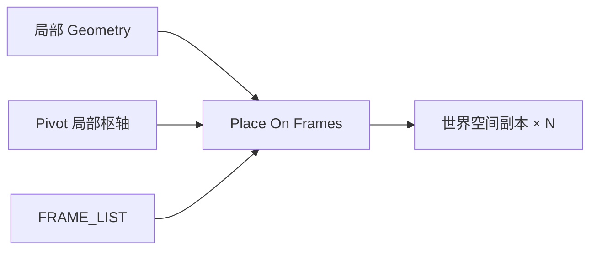

# Place Geometry On Frames

| 字段 | 值 |
|---|---|
| 节点 ID | `transform.placement.place_geometry_on_frames` |
| 分类 | `transform.placement` |
| 显示名称 | Place Geometry On Frames |
| 效果 | `PURE` |

## 作用

把几何副本放到 Frame / FRAME_LIST：Pivot → 各 Frame 原点，局部轴对齐 Frame X/Y/Z。Frame 与 Frames 互斥。

## 示意图



```text
  局部模型          Frame0        Frame1        Frame2
  ·──X               X·            X·            X·
  │                  │Y            │Y            │Y
  Pivot ★  ──放置──► ★             ★             ★
```

Pivot 映到每个 Frame 原点；模型局部轴对齐该 Frame 的 X/Y/Z。

## 端点

| 方向 | 显示名 | 类型 |
|---|---|---|
| 入 | Geometry / Pivot / Frame / Frames | GEOMETRY / POINT / FRAME / FRAME_LIST |
| 出 | Geometry / Count | GEOMETRY / INTEGER |
| 出 | Valid / Error | `output_valid` / `output_error` | BOOLEAN / STRING |

## 使用步骤

1. 接入几何或点列，以及变换/阵列参数。
2. 输出接到下游放置、预览或体素化。

## 典型接法

```text
[Window Frame].Geometry ──► Geometry
[Window Array].Frames ──► Frames
原点 Pivot ──► Pivot
```
