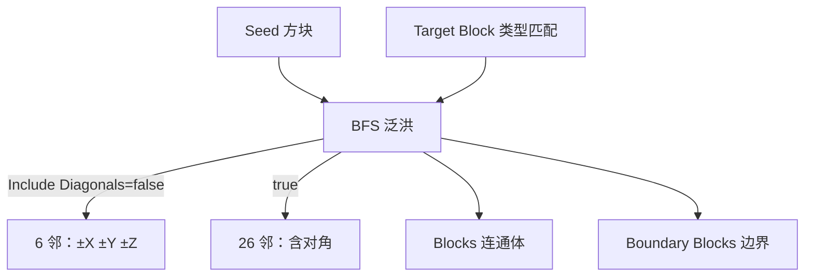

# Flood Fill

| 字段 | 值 |
|---|---|
| 节点 ID | `world.query.flood_fill` |
| 分类 | `world.query` |
| 显示名称 | Flood Fill |
| 效果 | `WORLD_READ` |

## 作用

从种子 BFS 泛洪（6/26 连通）。

## 示意图



```text
  Max Distance  限制曼哈顿/搜索半径类预算
  Max Blocks    硬上限；Hit Limit / Complete 报告是否截断
```

输出 Blocks 可接材质赋值或 Replace / Clear。

## 端点

| 方向 | 显示名 | 类型 |
|---|---|---|
| 入 | Seed | BLOCK_POS |
| 入 | Target Block | BLOCK_TYPE |
| 入 | Max Distance | INTEGER |
| 入 | Max Blocks | INTEGER |
| 入 | Include Diagonals | BOOLEAN |
| 出 | Blocks | BLOCK_LIST |
| 出 | Count | INTEGER |
| 出 | Target Block | BLOCK_TYPE |
| 出 | Boundary Blocks | BLOCK_LIST |
| 出 | Valid | BOOLEAN |
| 出 | Error | STRING |
| 出 | Stopped Reason | STRING |
| 出 | Visited Count | INTEGER |
| 出 | Skipped Count | INTEGER |
| 出 | Hit Limit | BOOLEAN |
| 出 | Complete | BOOLEAN |
| 出 | World Read Count | INTEGER |


## 使用步骤

1. Seed 接起点格；Target Block 指定要漫延的类型。
2. 按场景调 Max Distance / Max Blocks；需要对角连通时打开 Include Diagonals。
3. 检查 Complete / Hit Limit；Blocks 接到下游写入或分析。

## 典型接法

```text
[Selected Block].Block Position ──► [Flood Fill].Seed
[Block Type Selector] ──► Target Block
[Flood Fill].Blocks ──► [Assign Block Type] / [Clear Blocks]
```

## 注意事项

- 需要世界上下文；无世界时 Valid 可能为 false。
