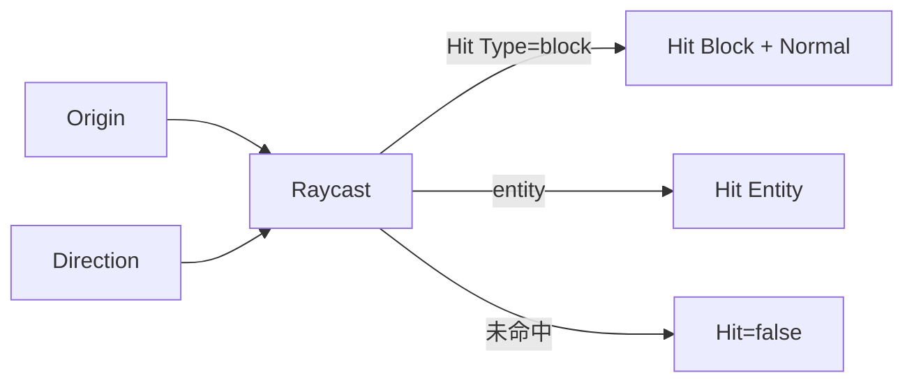

# Raycast

| 字段 | 值 |
|---|---|
| 节点 ID | `world.query.raycast` |
| 分类 | `world.query` |
| 显示名称 | Raycast |
| 效果 | `WORLD_READ` |

## 作用

世界空间射线，返回最近方块/实体命中。

## 示意图



```text
  Origin ●──────────────────► Direction
              ╲
               ● Hit Position
               │ Hit Normal
            [方块/实体]
```

玩家准星场景优先用 [Player View Raycast](../../input/context/player_raycast.md)；本节点可任意 Origin/Direction。

## 端点

| 方向 | 显示名 | 类型 |
|---|---|---|
| 入 | Origin | POINT |
| 入 | Direction | VECTOR |
| 入 | Max Distance | DOUBLE |
| 入 | Include Fluids | BOOLEAN |
| 入 | Check Entities | BOOLEAN |
| 入 | Entity Radius | DOUBLE |
| 出 | Hit | BOOLEAN |
| 出 | Hit Type | STRING |
| 出 | Hit Position | POINT |
| 出 | Hit Block Position | BLOCK_POS |
| 出 | Hit Normal | VECTOR |
| 出 | Hit Entity | MINECRAFT_ENTITY |
| 出 | Distance | DOUBLE |
| 出 | Valid | BOOLEAN |
| 出 | Error | STRING |


## 使用步骤

1. 接好查询/预览对象（区域、坐标、几何等）。
2. 运行后查看输出；预览类不写世界，清理用 Clear Preview。

## 典型接法

```text
[上游].… ──► [Raycast].Origin
[Raycast].Hit ──► [下游].…
```

## 注意事项

- 需要世界上下文；无世界时 Valid 可能为 false。
