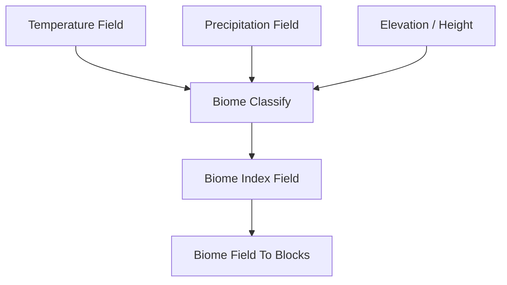

# Biome Classify

| 字段 | 值 |
|---|---|
| 节点 ID | `world.terrain.biome_classify` |
| 分类 | `world.terrain` |
| 显示名称 | Biome Classify |
| 效果 | `PURE` |

## 作用

温/降水/高程 → 生物群系索引。

## 示意图



```text
  高程 ↑
       │  冻原 / 雪
       │  草原 ─ 森林 ─ 雨林   ← 降水 →
       │  沙漠 / 荒地
  温度 ──────────────→
```

上游常接 Temperature / Precipitation / Combine Height；下游用调色板铺表面。

## 端点

| 方向 | 显示名 | 类型 |
|---|---|---|
| 入 | Temperature Field | SCALAR_FIELD |
| 入 | Precipitation Field | SCALAR_FIELD |
| 入 | Height Field | SCALAR_FIELD |
| 出 | Biome Id Field | SCALAR_FIELD |
| 出 | Biome Labels | STRING_LIST |
| 出 | Biome Count | INTEGER |
| 出 | Valid | BOOLEAN |
| 出 | Error | STRING |

## 使用步骤

1. 接好查询/预览对象（区域、坐标、几何等）。
2. 运行后查看输出；预览类不写世界，清理用 Clear Preview。

## 典型接法

```text
[上游].… ──► [Biome Classify].Temperature Field
[Biome Classify].Biome Id Field ──► [下游].…
```
