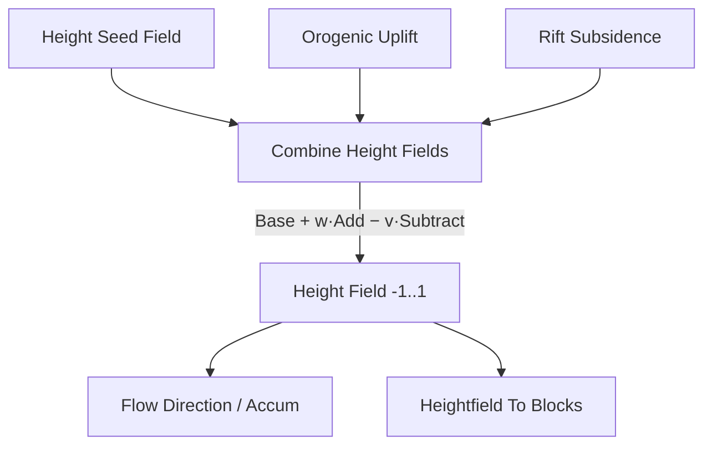

# Combine Height Fields

| 字段 | 值 |
|---|---|
| 节点 ID | `world.terrain.combine_height_fields` |
| 分类 | `world.terrain` |
| 显示名称 | Combine Height Fields |
| 效果 | `PURE` |

## 作用

基/加/减高度场合成归一化 [-1,1]。

## 示意图



```text
  Height = normalize( Base + AddWeight·Add − SubtractWeight·Subtract )
```

典型造山链：Seed → Plate → Uplift/Rift → **Combine** → 侵蚀步 → To Blocks。

## 端点

| 方向 | 显示名 | 类型 |
|---|---|---|
| 入 | Base Field | SCALAR_FIELD |
| 入 | Add Field | SCALAR_FIELD |
| 入 | Subtract Field | SCALAR_FIELD |
| 入 | Add Weight | DOUBLE |
| 入 | Subtract Weight | DOUBLE |
| 出 | Height Field | SCALAR_FIELD |
| 出 | Valid | BOOLEAN |
| 出 | Error | STRING |

## 使用步骤

1. Base 接大陆种子场；Add / Subtract 接抬升或沉降场（可空）。
2. 调 Add / Subtract Weight；确认输出仍在合理 [-1,1] 范围。
3. Height Field 接侵蚀管线或 Heightfield To Blocks。

## 典型接法

```text
[Height Seed].Field ──► Base Field
[Orogenic Uplift].Field ──► Add Field
[Rift Subsidence].Field ──► Subtract Field
[Combine].Height Field ──► [Heightfield To Blocks]
```
