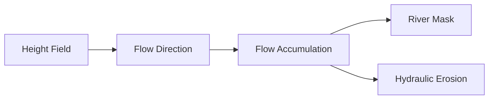

# Flow Accumulation Field

| 字段 | 值 |
|---|---|
| 节点 ID | `world.terrain.flow_accumulation_field` |
| 分类 | `world.terrain` |
| 显示名称 | Flow Accumulation Field |
| 效果 | `PURE` |

## 作用

径流汇集（快速或高质量 MFD）。

## 示意图



```text
  分水岭
    ╲  ╱
     ╲╱  →→ 汇流增大
      │
   高 Accumulation ≈ 河道候选
  模式：快速单向下坡 / 高质量 MFD 多向下坡
```

## 端点

| 方向 | 显示名 | 类型 |
|---|---|---|
| 入 | Region | REGION |
| 入 | Flow Field | VECTOR_FIELD |
| 入 | Rain Field | SCALAR_FIELD |
| 入 | Iterations | INTEGER |
| 出 | Accumulation Field | SCALAR_FIELD |
| 出 | Stride | INTEGER |
| 出 | Grid Width | INTEGER |
| 出 | Grid Depth | INTEGER |
| 出 | Cell Count | INTEGER |
| 出 | Was Downsampled | BOOLEAN |
| 出 | Valid | BOOLEAN |
| 出 | Error | STRING |

## 使用步骤

1. 接好查询/预览对象（区域、坐标、几何等）。
2. 运行后查看输出；预览类不写世界，清理用 Clear Preview。

## 典型接法

```text
[上游].… ──► [Flow Accumulation Field].Region
[Flow Accumulation Field].Accumulation Field ──► [下游].…
```
