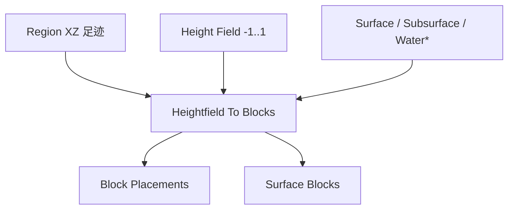

# Heightfield To Blocks

| 字段 | 值 |
|---|---|
| 节点 ID | `world.terrain.heightfield_to_blocks` |
| 分类 | `world.terrain` |
| 显示名称 | Heightfield To Blocks |
| 效果 | `PURE` |

## 作用

区域内归一化高度场 → 地形放置。

## 示意图



```text
  高度场采样（每柱）
       ▲ Y
       │  ██ Surface
       │  ██
       │  ▓▓ Subsurface …
  ─────┼──────── XZ
     Water Level → 水位以下可铺 Water Block
```

上游常见：[Combine Height Fields](./combine_height_fields.md) → 本节点 → Apply。

## 端点

| 方向 | 显示名 | 类型 |
|---|---|---|
| 入 | Region | REGION |
| 入 | Height Field | SCALAR_FIELD |
| 入 | Surface Block | BLOCK_TYPE |
| 入 | Subsurface Block | BLOCK_TYPE |
| 入 | Water Level | DOUBLE |
| 入 | Water Block | BLOCK_TYPE |
| 入 | Step | INTEGER |
| 入 | Fill Tiles | BOOLEAN |
| 入 | Fill Depth | INTEGER |
| 入 | Max Columns | INTEGER |
| 入 | Max Placements | INTEGER |
| 出 | Block Placements | BLOCK_PLACEMENT_LIST |
| 出 | Surface Blocks | BLOCK_LIST |
| 出 | Column Count | INTEGER |
| 出 | Placement Count | INTEGER |
| 出 | Hit Limit | BOOLEAN |
| 出 | Complete | BOOLEAN |
| 出 | Stopped Reason | STRING |
| 出 | Valid | BOOLEAN |
| 出 | Error | STRING |

## 使用步骤

1. 接好查询/预览对象（区域、坐标、几何等）。
2. 运行后查看输出；预览类不写世界，清理用 Clear Preview。

## 典型接法

```text
[上游].… ──► [Heightfield To Blocks].Region
[Heightfield To Blocks].Block Placements ──► [下游].…
```
