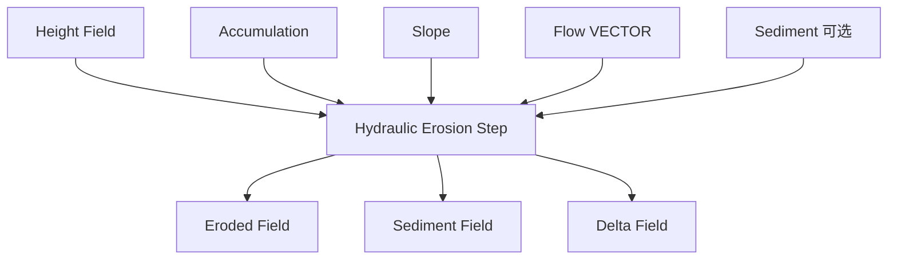

# Hydraulic Erosion Step

| 字段 | 值 |
|---|---|
| 节点 ID | `world.terrain.hydraulic_erosion_step` |
| 分类 | `world.terrain` |
| 显示名称 | Hydraulic Erosion Step |
| 效果 | `PURE` |

## 作用

一步水力侵蚀-沉积（携沙能力）。

## 示意图



```text
  高处 / 急流 ──侵蚀──► 泥沙进入 Sediment
  低处 / 缓流 ◄──沉积── 超过 Capacity 则落淤
  可多步迭代：Eroded → 下一 Step 的 Height
```

上游常接 [Flow Accumulation](./flow_accumulation_field.md)；Delta 可进 [Delta Accumulate](./delta_accumulate_field.md)。

## 端点

| 方向 | 显示名 | 类型 |
|---|---|---|
| 入 | Region | REGION |
| 入 | Height Field | SCALAR_FIELD |
| 入 | Accumulation Field | SCALAR_FIELD |
| 入 | Slope Field | SCALAR_FIELD |
| 入 | Flow Field | VECTOR_FIELD |
| 入 | Sediment Field | SCALAR_FIELD |
| 入 | Erosion Rate | DOUBLE |
| 入 | Deposition Rate | DOUBLE |
| 入 | Capacity | DOUBLE |
| 入 | Transport Efficiency | DOUBLE |
| 出 | Eroded Field | SCALAR_FIELD |
| 出 | Sediment Field | SCALAR_FIELD |
| 出 | Delta Field | SCALAR_FIELD |
| 出 | Valid | BOOLEAN |
| 出 | Error | STRING |

## 使用步骤

1. 接好查询/预览对象（区域、坐标、几何等）。
2. 运行后查看输出；预览类不写世界，清理用 Clear Preview。

## 典型接法

```text
[上游].… ──► [Hydraulic Erosion Step].Region
[Hydraulic Erosion Step].Eroded Field ──► [下游].…
```
