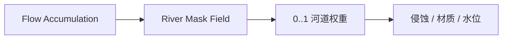

# River Mask Field

| 字段 | 值 |
|---|---|
| 节点 ID | `world.terrain.river_mask_field` |
| 分类 | `world.terrain` |
| 显示名称 | River Mask Field |
| 效果 | `PURE` |

## 作用

由汇流生成河道掩码场。

## 示意图



```text
  高 Accumulation ──阈值──► Mask≈1 河道
  低 Accumulation          Mask≈0 旱地
```

常接在 [Flow Accumulation](./flow_accumulation_field.md) 之后，用于雕刻谷底或铺水。

## 端点

| 方向 | 显示名 | 类型 |
|---|---|---|
| 入 | Accumulation Field | SCALAR_FIELD |
| 入 | Threshold | DOUBLE |
| 入 | Min Order | INTEGER |
| 出 | River Mask Field | SCALAR_FIELD |
| 出 | Valid | BOOLEAN |
| 出 | Error | STRING |

## 使用步骤

1. 接好查询/预览对象（区域、坐标、几何等）。
2. 运行后查看输出；预览类不写世界，清理用 Clear Preview。

## 典型接法

```text
[上游].… ──► [River Mask Field].Accumulation Field
[River Mask Field].River Mask Field ──► [下游].…
```
