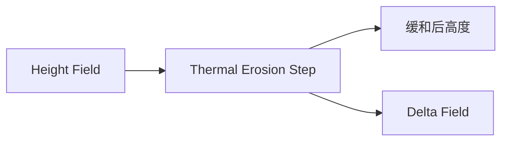

# Thermal Erosion Step

| 字段 | 值 |
|---|---|
| 节点 ID | `world.terrain.thermal_erosion_step` |
| 分类 | `world.terrain` |
| 显示名称 | Thermal Erosion Step |
| 效果 | `PURE` |

## 作用

一步热侵蚀（超休止角）。

## 示意图



```text
  陡坡 > 休止角     ██
                   ██╲  →  物质滚落
                   ██ ╲██     坡顶降低、坡脚抬高
  多步迭代直到坡度稳定
```

水力过程见 [Hydraulic Erosion Step](./hydraulic_erosion_step.md)。

## 端点

| 方向 | 显示名 | 类型 |
|---|---|---|
| 入 | Region | REGION |
| 入 | Height Field | SCALAR_FIELD |
| 入 | Talus | DOUBLE |
| 入 | Rate | DOUBLE |
| 出 | Height Field | SCALAR_FIELD |
| 出 | Delta Field | SCALAR_FIELD |
| 出 | Valid | BOOLEAN |
| 出 | Error | STRING |

## 使用步骤

1. 接好查询/预览对象（区域、坐标、几何等）。
2. 运行后查看输出；预览类不写世界，清理用 Clear Preview。

## 典型接法

```text
[上游].… ──► [Thermal Erosion Step].Region
[Thermal Erosion Step].Height Field ──► [下游].…
```
